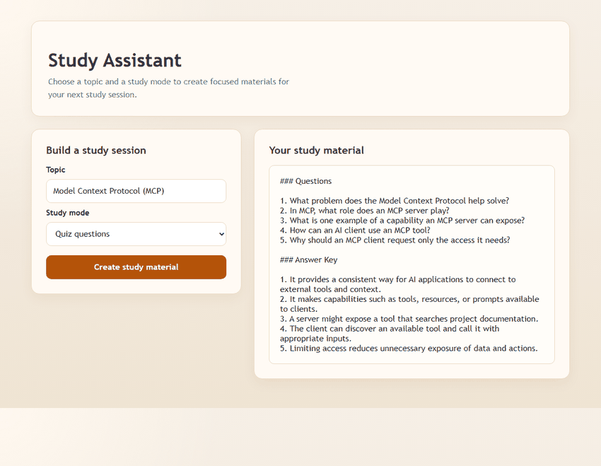

# AI Study Assistant

[](https://www.python.org/)
[](https://flask.palletsprojects.com/)
[](https://platform.openai.com/docs/api-reference/responses)

This is a Flask app that creates quiz questions, concise summaries, and study plans with OpenAI.

**Tech stack:** Python, Flask, OpenAI Responses API (`gpt-4o-mini`), HTML, CSS.

## Preview

Animated preview using Model Context Protocol (MCP) as the topic, cycling through quiz, summary, and study-plan outputs:



## Setup

```powershell
python -m pip install -r requirements.txt
Copy-Item .env.example .env
```

Add your OpenAI API key to `.env`:

```text
OPENAI_API_KEY=your_api_key_here
```

Run the app:

```powershell
python app.py
```

Open http://localhost:5000. Keep `.env` private; it is excluded from Git.
